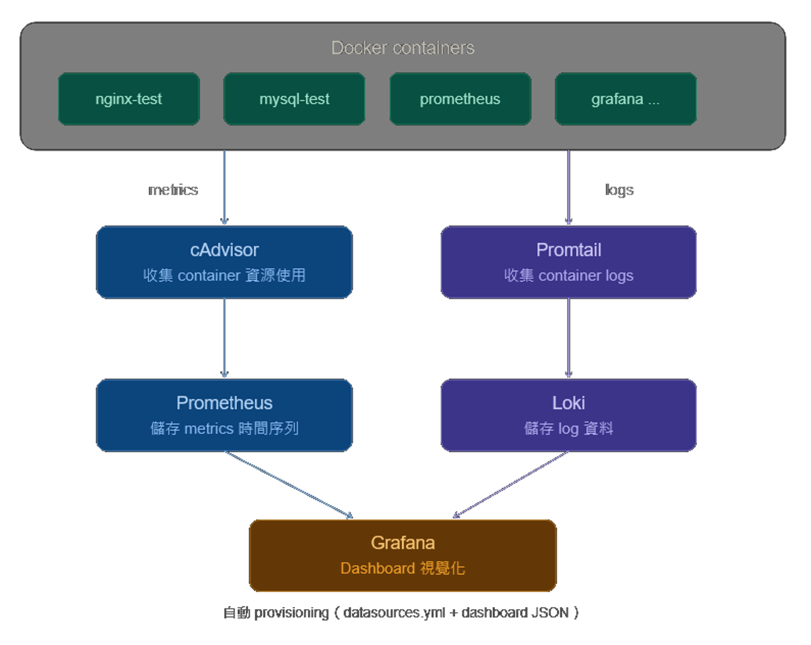
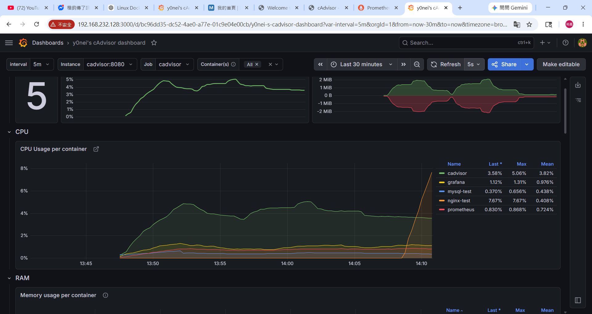
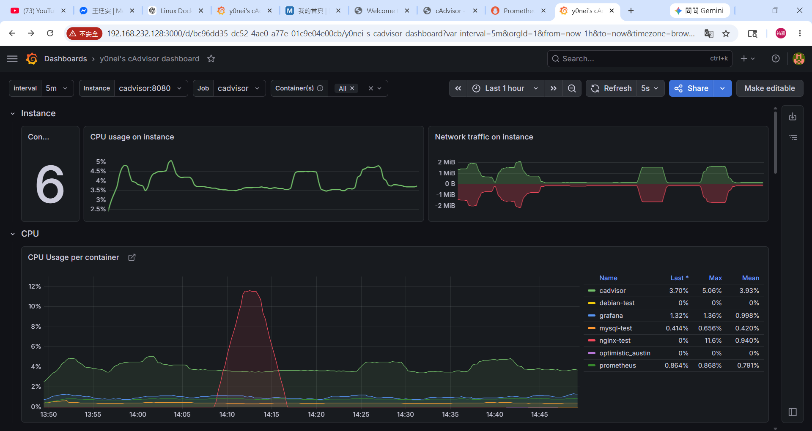
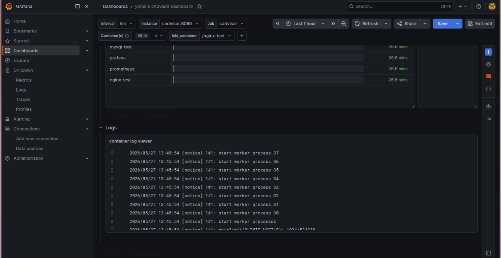

# Docker monitoring

## 簡易說明
此為國立中央大學Linux與邊緣運算課程中本組的 final project ，內容為在 Ubuntu Linux 上搭建一個 docker 監控平台。

## Tools
- cadvisor: 收集並分析運行中容器（如 Docker、Kubernetes）的 CPU、記憶體、網路頻寬與磁碟 I/O 等效能數據
- prometheus: 透過提取（Pull）模型定期收集應用程式與基礎架構的指標（Metrics），儲存為時間序列資料
- grafana: 資料視覺化與分析平台
- Loki: 儲存 logs 工具
- Promtail: 收集 container logs 工具

## Workflow




## 架構
```
Ubuntu Linux
│
└── Docker Engine
    │
    ├── cAdvisor
    │     └── 收集 container 資訊
    │
    ├── Prometheus
    │     └── 儲存監控資料
    │
    ├── Promtail
    │     └── 收集 container logs
    │
    ├── Loki
    │     └── 儲存 log 資料
    │
    ├── Grafana
    │     └── 顯示 dashboard
    │     └── 自動 provisioning（datasources + dashboard JSON）
    │
    └── 你自己的測試 containers
          ├── nginx
          ├── mysql
          └── app container
```


## Docker compose

### 專案結構
```
monitoring-project/
│
├── docker-compose.yml
│
├── prometheus/
│     └── prometheus.yml
│
├── promtail/
│     └── promtail.yml
│
└── grafana/
        └── provisioning/
            ├── datasources/
            │   └── datasources.yml
            └── dashboards/
                ├── dashboards.yml
                └── docker-monitoring.json
```

### docker-compose.yml
註: 由於 linux 於課堂上安裝過 mysql (如果有在上課的話w)，其會占用主機的 3306 port，所以這邊用 3307 port

### 完成後執行
```docker compose up -d```
註: 虛擬機最好分配足夠的 RAM 以及 Disk ，太小 container 會跑不起來(我用 4 GB + 50 GB ok)

### 確認一下 container
```docker ps```

### 若要關掉
```docker compose down```

## 進入各項工具服務

### cadvisor
```http://主機ip:8080```
進去後應該要能看到一些圖表

### prometheus
```http://主機ip:9090```
可以輸入```container_memory_usage_bytes```後按 execute 來測試一下有沒有東西 (應該會有一堆字)

### grafana
```http://主機ip:3000```
預設帳號: ```admin```
預設密碼: ```admin```

### nginx
```http://主機ip:8081```

## 建立 dashboard
這時候 grafana 應該還沒讀到 prometheus 的資料
左側欄位:
```
Connections
→ Data Sources
→ Add data source
→ Prometheus
```

輸入 ```http://prometheus:9090```
然後 save

就可以在左側欄位:
```
Drilldown
→ Metrics
```
看見讀到的一些資訊

之後可以匯入別人做好的 dashboard 或是自己做
可以去這邊找: https://grafana.com/grafana/dashboards/

這邊先匯入dashboard ID: ```19724```

### 新增Log 檢視
同樣的方法讀loki 的資料
輸入```http://loki:3100```

回到dashboard，右上角Make editable進入編輯模式
右邊齒輪新增一個Query型別的變數
```
Target data source: loki
Query type: Label values
Label: container
```
然後在任意處新增row，row中新增panel，Configure visualization 編輯panel

data source: loki
query選用builder
下拉式選單，選擇container = $剛剛新增的變數名稱
run query然後save就完成了

## Test

### 操爛 nginx

進入nginx
```docker exec -it nginx-test sh```

簡單操一下
```while true; do echo hello; done```



效果顯著

### 新增 container

開一個新的 container 看看
```docker run -it --name debian-test debian:latest /bin/bash```



### 檢視logs
這邊使用loki_container作為loki的container變數
使用下拉選單選想看的container就可以看到該container的logs
